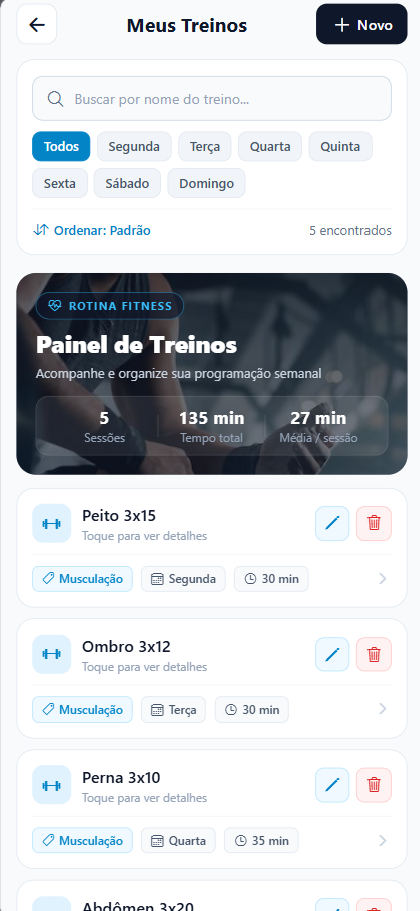
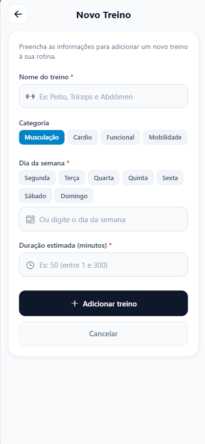
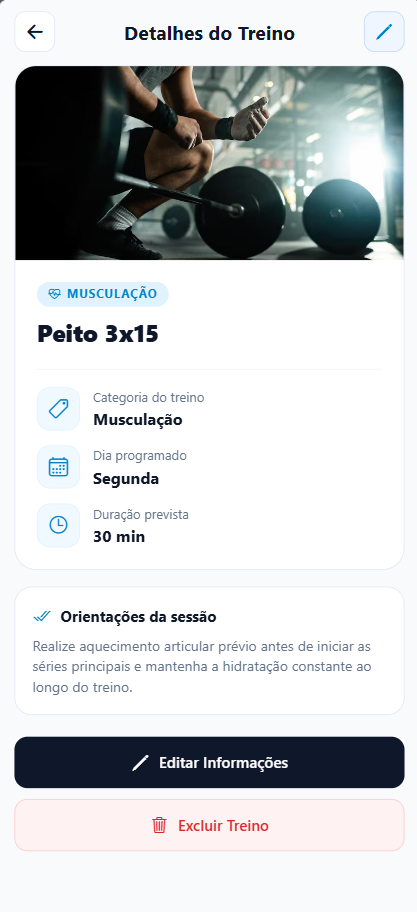

# Gestão Academia

Sistema multiplataforma para apoiar a gestão de uma academia.

## Sobre

Este repositório reúne os três módulos do projeto: a API REST, o site e o aplicativo mobile. As ferramentas compartilhadas, como os hooks de commit, ficam na raiz.

| Módulo            | O que é    | Tecnologias                       | Documentação                                    |
| ----------------- | ---------- | --------------------------------- | ----------------------------------------------- |
| `backend/spring/` | API REST   | Spring Boot, Java 17 e PostgreSQL | [README do backend](./backend/spring/README.md) |
| `web/`            | Site       | Next.js, React e TypeScript       | [README do web](./web/README.md)                |
| `mobile/`         | Aplicativo | Expo, React Native e TypeScript   | [README do mobile](./mobile/README.md)          |

## Documentação do domínio

Os documentos de domínio do projeto estão em [`docs/jdbc/`](./docs/jdbc/):

- [Minimundo](./docs/jdbc/MINIMUNDO_V4.md)
- [Requisitos](./docs/jdbc/REQUISITOS.md)
- [Modelagem da entidade principal](./docs/jdbc/MODELAGEM.md)
- [Diagramas conceitual e lógico](./docs/jdbc/DIAGRAMAS.md), com links para os modelos interativos e imagens locais

## Estrutura

```text
.
├── .github/                  # Modelos de issues e pull requests, e CI
├── .husky/                   # Hooks de commit
├── backend/                  # API Spring Boot
├── docs/                     # Documentação do domínio e capturas de tela
│   ├── capturas-de-tela/     # Capturas de tela do aplicativo
│   └── jdbc/                 # Minimundo, requisitos, modelagem e diagramas
├── mobile/                   # Aplicativo Expo
├── web/                      # Site Next.js
├── mise.toml                 # Versões do Node.js e do Java, e tarefas do projeto
├── package.json              # Ferramentas de commit da raiz
├── README.md
└── CONTRIBUTING.md
```

## Como executar

Recomendamos usar o [mise](https://mise.jdx.dev/) para instalar e gerenciar o Node.js e o Java do projeto. Todos os comandos abaixo são executados na raiz do repositório.

### Preparação

Instale os runtimes e as dependências uma vez:

```bash
mise install
mise run install
```

`mise install` instala o Node.js e o Java nas versões do projeto. `mise run install` instala as dependências da raiz, do `mobile/` e do `web/`.

### Rodar os módulos

Cada módulo roda em um terminal próprio. Antes de rodar o backend pela primeira vez, siga a [configuração local do backend](./backend/spring/README.md#configuração-local), que cria o banco e o arquivo `backend/spring/.env`.

API em http://localhost:8080:

```bash
mise run dev:backend
```

Site em http://localhost:3000:

```bash
mise run dev:web
```

Aplicativo no Expo, onde você escolhe Android, iOS ou navegador:

```bash
mise run dev:mobile
```

### Outras tarefas

Os nomes seguem o padrão `mise run <ação>:<módulo>`. Sem o módulo, a tarefa roda em todos os que têm aquela ação. Para ver a lista completa, use `mise tasks`.

| Comando                 | O que faz                                                                  |
| ----------------------- | -------------------------------------------------------------------------- |
| `mise run lint`         | Roda Prettier, ESLint e TypeScript no mobile, e ESLint e TypeScript no web |
| `mise run test:backend` | Roda os testes do backend (ainda não há testes)                            |
| `mise run build`        | Empacota o backend e gera o build do web                                   |

## Capturas de tela

As capturas de tela do aplicativo ficam organizadas em [`docs/capturas-de-tela/`](./docs/capturas-de-tela/).

|                                         Tela Inicial                                         |                                 Listagem Inteligente & Estatísticas                                 |                                                     Cadastro & Edição                                                     |                                         Detalhes da Sessão                                          |
| :------------------------------------------------------------------------------------------: | :-------------------------------------------------------------------------------------------------: | :-----------------------------------------------------------------------------------------------------------------------: | :-------------------------------------------------------------------------------------------------: |
|  |  |  |  |

## Protótipo mobile

O protótipo da interface mobile está disponível no [Figma](https://www.figma.com/proto/yjRxhNBA2eSLiNGXFwswcn/Aplicativo-de-rede-de-academias?node-id=0-1&t=wmaNHiS11XvZoqm8-1).

## Contribuindo

Consulte [CONTRIBUTING.md](./CONTRIBUTING.md) para as orientações gerais de contribuição.

## Orientações para agentes

As regras gerais para trabalhar no monorepo estão em [`docs/agent-guidelines.md`](./docs/agent-guidelines.md). As instruções operacionais para agentes ficam em [`AGENTS.md`](./AGENTS.md).

## Skills dos agentes

As skills compartilhadas ficam em [`.agents/skills/`](./.agents/skills/). O Gemini CLI e o Mistral Vibe descobrem as skills nesse caminho; cada skill tem sua própria pasta com um arquivo `SKILL.md`.
