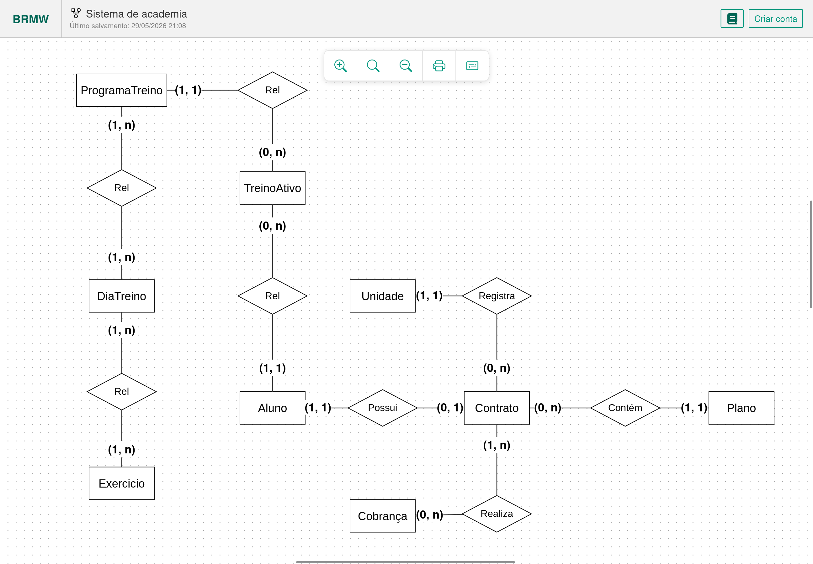
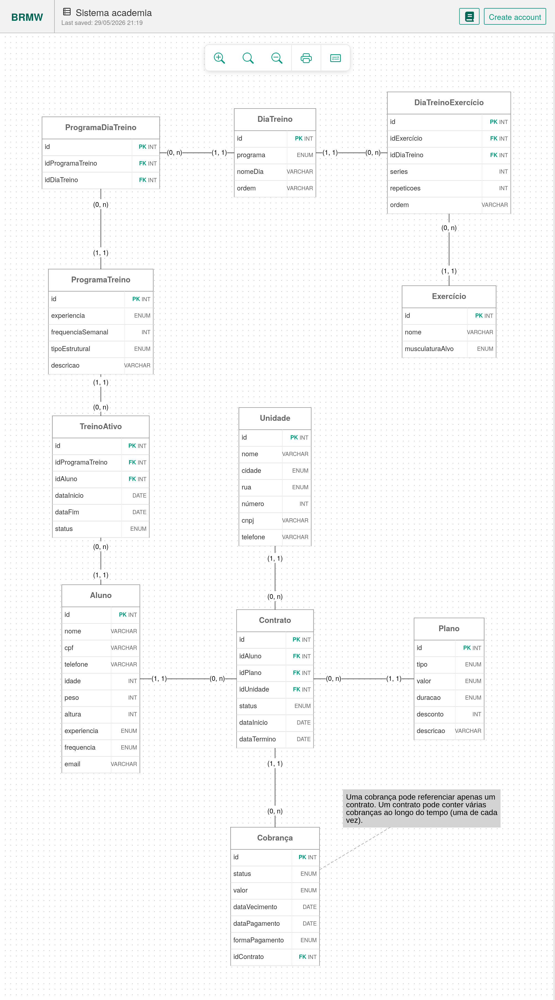

# Minimundo — Sistema de Gestão de Academia 

**Instituto Federal de Educação, Ciência e Tecnologia da Paraíba**
Campus Esperança
Curso de Análise e Desenvolvimento de Sistemas

Disciplina: Desenvolvimento de Aplicações Web II
Grupo: Samuel Cláudio Duarte Lima, João Augusto Silva de Araújo, Arley Andrey Alves Pereira, Miguel Rodrigo da Silva Normando

---

## Visão Geral do Sistema 

O **Sistema de Gestão de Academia** é uma solução integrada projetada para centralizar o controle financeiro, o acesso físico e a prescrição de treinos em redes de academias. O sistema gerencia múltiplas unidades físicas com uma base de dados unificada, permitindo que alunos matriculados em qualquer unidade tenham seus dados e situação financeira acessíveis em toda a rede. A solução automatiza a geração de cobranças, o controle de acesso via catraca, a prescrição personalizada de treinos e o envio de notificações via WhatsApp, eliminando inconsistências em pagamentos e padronizando a experiência do aluno.

*Diagrama Conceitual do Sistema*

*Modelo Entidade Relacionamento*

---

## Mais Informações 

Para detalhes completos sobre o domínio, regras de negócio e especificações técnicas, consulte os seguintes documentos:

- [Minimundo Completo](docs/MINIMUNDO_V4.md)
- [Documento de Requisitos](docs/REQUISITOS_V1.md)
