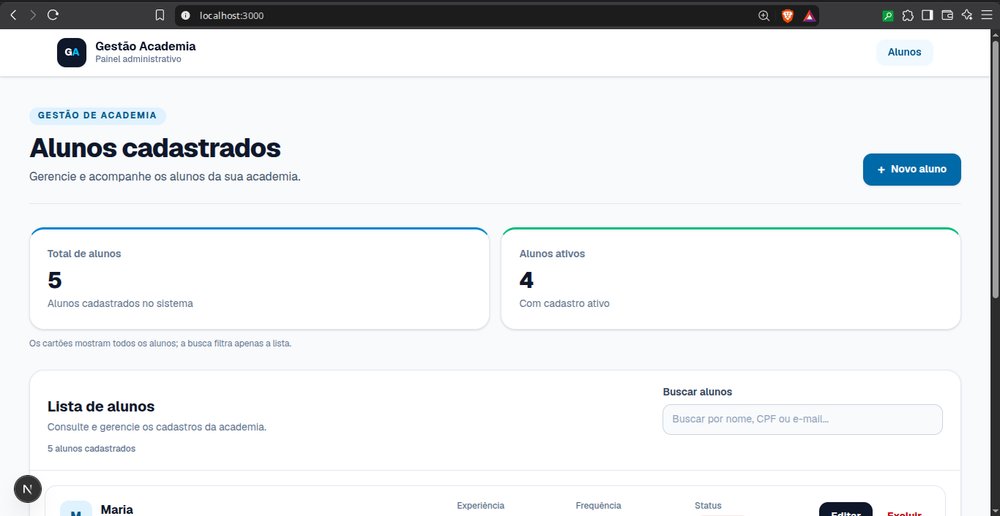

# API Spring Boot

API REST do sistema de gestão de academia, desenvolvida com Spring Boot e Java 17. O código da aplicação fica em `src/`, e o projeto inclui o Maven Wrapper (`mvnw`) para executar tarefas Maven.

## Capturas de tela

**Documentação Swagger UI**



## Pré-requisitos

- [mise](https://mise.jdx.dev/) para instalar e selecionar o Java 17 configurado no monorepo;
- PostgreSQL instalado e em execução na máquina.

Na raiz do repositório, instale os runtimes do projeto:

```bash
mise install
```

## Configuração local

O backend utiliza uma instância local do PostgreSQL. Crie o banco de dados `gestao_academia` e configure um usuário com permissão de acesso. Ajuste os valores de conexão conforme sua instalação.

Crie `backend/spring/.env` a partir do exemplo:

```bash
cp backend/spring/.env.example backend/spring/.env
```

O exemplo define as variáveis `SPRING_DATASOURCE_URL`, `SPRING_DATASOURCE_USERNAME` e `SPRING_DATASOURCE_PASSWORD`, usadas por `src/main/resources/application.properties`. Atualize os valores para corresponder ao PostgreSQL local. O arquivo `.env` é local e está ignorado pelo Git.

## Executar

Na raiz do monorepo:

```bash
mise run dev:backend
```

A tarefa carrega `backend/spring/.env`, verifica se o arquivo existe e executa `./mvnw spring-boot:run` em `backend/spring/`. A API fica disponível em http://localhost:8080 e a documentação Swagger em http://localhost:8080/swagger-ui.html.

Se preferir executar o Maven Wrapper sem mise, rode da raiz do repositório:

```bash
(set -a; . backend/spring/.env; set +a; cd backend/spring && ./mvnw spring-boot:run)
```

Na IDE, configure as mesmas três variáveis de ambiente para a aplicação Spring Boot.

## Testar e empacotar

Os comandos também são executados na raiz do monorepo:

```bash
mise run test:backend
mise run build:backend
```

`test:backend` executa `./mvnw test` em `backend/spring/`. A suíte inicial cobre o serviço e o controller de alunos; os demais recursos ainda não têm cobertura automatizada. `build:backend` executa `./mvnw package` e gera os artefatos Maven em `backend/spring/target/`.
