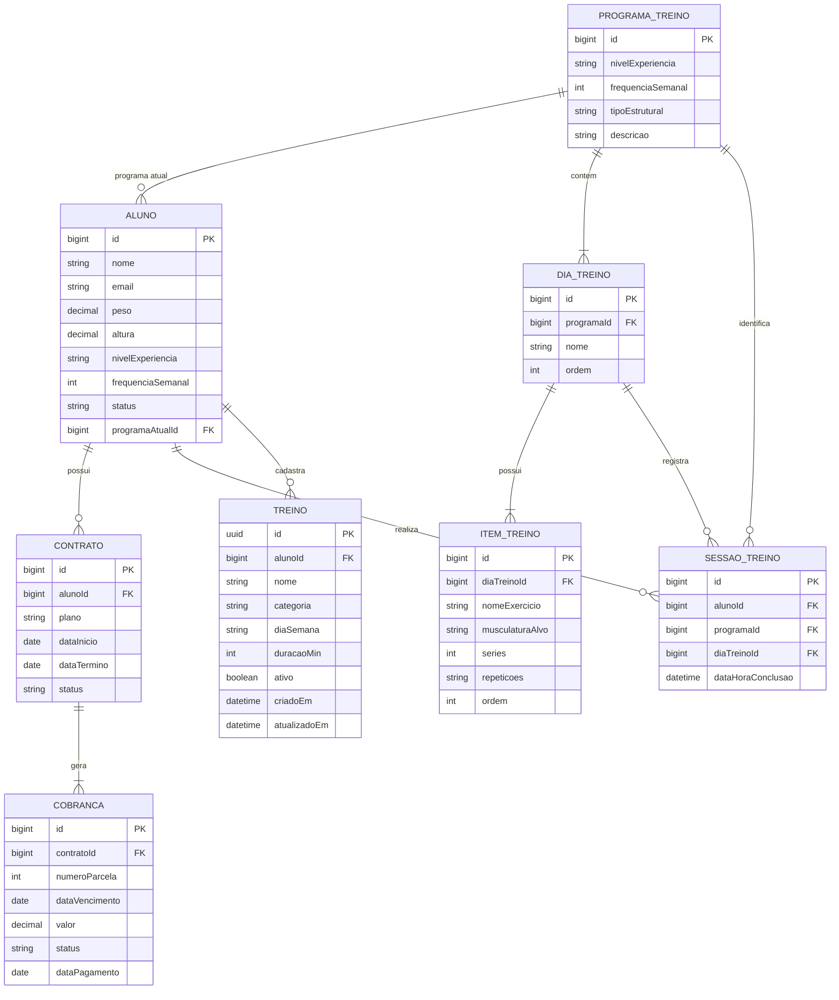

# Diagrama Entidade-Relacionamento (ER)

Diagrama do modelo de dados da versão V6 com suporte à gestão de treinos mobile e persistência na nuvem. O conteúdo está em Mermaid para facilitar a visualização em editores compatíveis.

