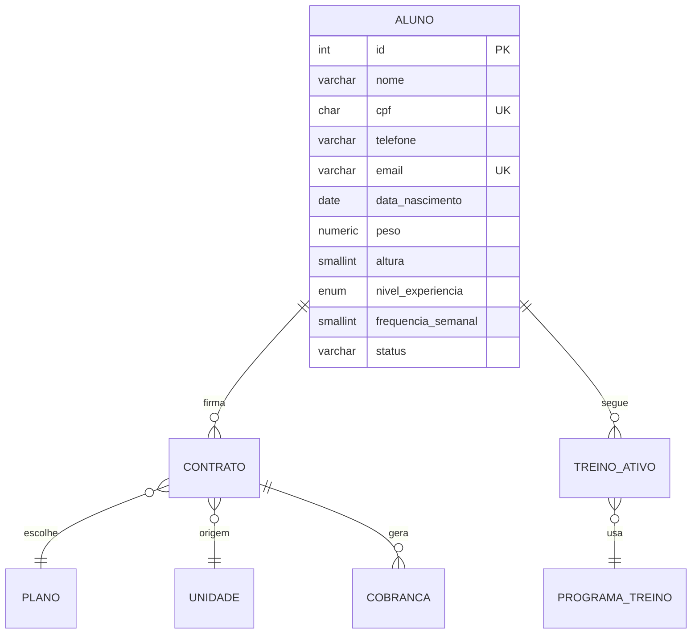

# Modelagem da entidade principal: Aluno

Documento de modelagem do banco de dados do sistema de gestão de academia.
Banco: PostgreSQL (NeonDB). Fonte: Minimundo do projeto e modelo lógico anterior.

## 1. Visão geral

A entidade principal do sistema é o **Aluno**. Ele é o centro do domínio:
contratos, treinos ativos e cobranças dependem dele, e o status do aluno
define o acesso físico à academia (catraca).

O aluno pertence à rede como um todo e não é vinculado diretamente a uma
unidade; a unidade de origem é registrada no contrato. O perfil do aluno
(nível de experiência e frequência semanal) define automaticamente o programa
de treino dele.

## 2. Atributos

| Campo               | Tipo (PostgreSQL)  | Obrigatório | Regra                                                                  |
|---------------------|--------------------|-------------|------------------------------------------------------------------------|
| id                  | integer (identity) | sim         | chave primária, gerada automaticamente                                 |
| nome                | varchar(150)       | sim         | nome completo                                                          |
| cpf                 | char(11)           | sim         | exatamente 11 dígitos (garantido por `CHECK`), único                   |
| telefone            | varchar(20)        | sim         | usado nas notificações via WhatsApp (RN07)                             |
| email               | varchar(150)       | sim         | único; o formato é validado na aplicação (o banco garante só a unicidade) |
| data_nascimento     | date               | sim         | a idade é calculada a partir dela                                      |
| peso                | numeric(5,2)       | sim         | em quilos, maior que 0                                                 |
| altura              | smallint           | sim         | em centímetros, maior que 0                                            |
| nivel_experiencia   | enum               | sim         | Iniciante, Intermediário ou Avançado                                   |
| frequencia_semanal  | smallint           | sim         | 3, 4, 5 ou 6 dias                                                      |
| status              | varchar(10)        | sim         | ativo ou inativo, padrão ativo; mantido pelo sistema                   |

## 3. Script SQL

```sql
CREATE TYPE nivel_experiencia AS ENUM ('Iniciante', 'Intermediário', 'Avançado');

CREATE TABLE aluno (
  id                 integer GENERATED ALWAYS AS IDENTITY PRIMARY KEY,
  nome               varchar(150) NOT NULL,
  cpf                char(11)     NOT NULL UNIQUE CHECK (cpf ~ '^[0-9]{11}$'),
  telefone           varchar(20)  NOT NULL,
  email              varchar(150) NOT NULL UNIQUE,
  data_nascimento    date         NOT NULL,
  peso               numeric(5,2) NOT NULL CHECK (peso > 0),   -- kg
  altura             smallint     NOT NULL CHECK (altura > 0), -- cm
  nivel_experiencia  nivel_experiencia NOT NULL,
  frequencia_semanal smallint     NOT NULL CHECK (frequencia_semanal IN (3, 4, 5, 6)),
  status             varchar(10)  NOT NULL DEFAULT 'ativo' CHECK (status IN ('ativo', 'inativo'))
);
```

## 4. Categorização, consulta e filtragem

- **Campos de categoria/status para filtro:** `nivel_experiencia`,
  `frequencia_semanal` e `status`
- **Busca:** por `nome` (parcial) e por `cpf` (exato)
- `cpf` e `email` já possuem índice por serem únicos

## 5. Relacionamentos

- Aluno 1:N Contrato (um contrato ativo por vez)
- Aluno 1:N TreinoAtivo (um treino ativo por vez; o histórico é preservado)
- Contrato N:1 Plano e N:1 Unidade
- Contrato 1:N Cobrança
- TreinoAtivo N:1 ProgramaTreino

Os diagramas do modelo (BRModelo) estão em [DIAGRAMAS.md](DIAGRAMAS.md).



## 6. Regras de negócio que afetam o Aluno

| # | Regra |
|---|---|
| RN03 | O cancelamento do contrato inativa o aluno e bloqueia o acesso na catraca |
| RN04 | Um aluno não pode ter mais de um contrato ativo simultaneamente |
| RN08 | Um aluno só pode ter um treino ativo por vez |
| RN09 | O programa de treino é escolhido pela combinação de nível e frequência |
| RN10 | Ao mudar nível ou frequência, o treino ativo é encerrado e um novo é criado |

## 7. Decisões e dúvidas em aberto

- [ ] **CPF e e-mail únicos:** proposta da modelagem; o Minimundo não diz isso
      explicitamente
- [ ] **Peso e altura obrigatórios:** o Minimundo diz que o cadastro "registra"
      esses dados
- [ ] **`status` como varchar ou enum:** nível usa enum; avaliar usar enum também
      no status por consistência
- [ ] **`idade` x `data_nascimento`:** o modelo lógico anterior tinha `idade`;
      aqui foi trocada por `data_nascimento`, conforme o Minimundo
- [ ] **Tipos incorretos no modelo anterior:** `valor` e `duracao` (Plano) e
      `valor` (Cobrança) estavam como ENUM; devem ser numérico e inteiro (dias)
- [ ] **Tabela `ProgramaDiaTreino`:** o modelo anterior a trata como N:M entre
      programa e dia, mas o Minimundo diz que o dia pertence a um programa (1:N)
      e que programas do mesmo tipo têm exercícios diferentes (RN11)
- [ ] **Padrão de nomes:** definir `snake_case` (`id_aluno`, `data_inicio`) para
      as colunas, que é o convencional no PostgreSQL
- [ ] **Índices parciais para RN04 e RN08**, a considerar na configuração do
      banco, por exemplo:
      `CREATE UNIQUE INDEX ... ON contrato (id_aluno) WHERE status = 'ativo'`