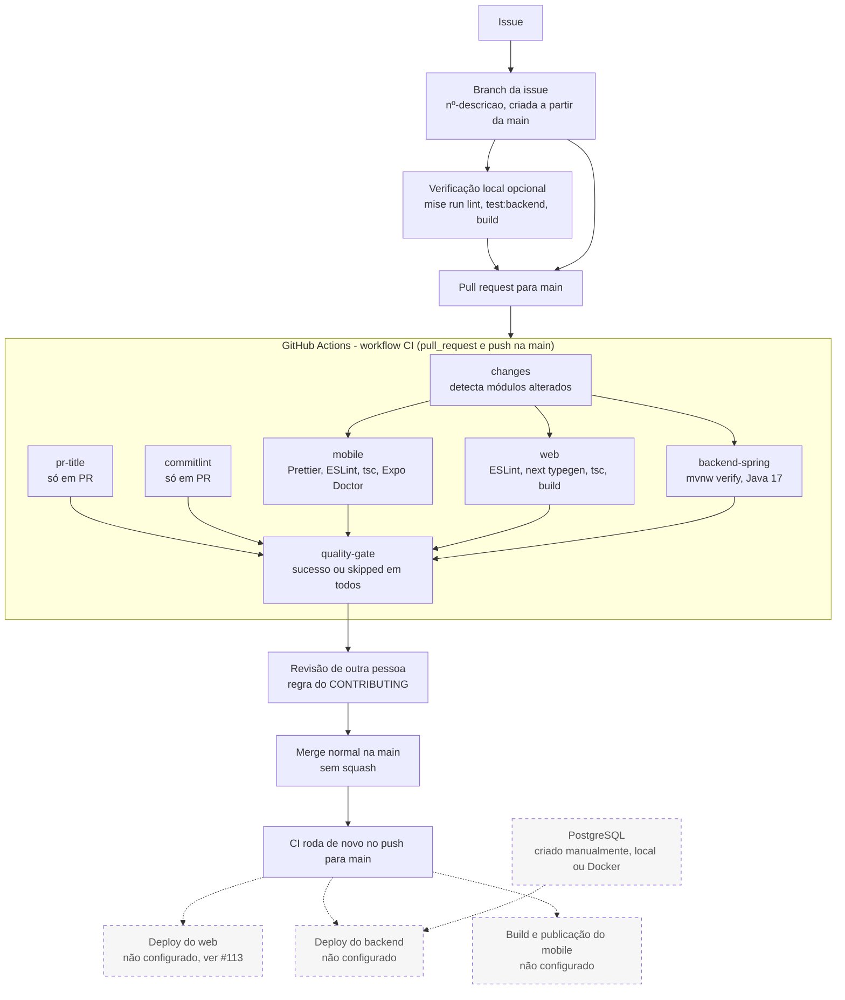

# Spec de CI/CD

Este documento descreve o fluxo atual de CI/CD do monorepo e define as regras que agentes e pessoas seguem ao trabalhar nele. Ele documenta o estado atual: não configura deploy automático (ver #113). Estado verificado em 14/11/2026 a partir de `.github/workflows/ci.yml`, `mise.toml`, `CONTRIBUTING.md` e das regras da branch `main` no GitHub.

## Fluxo Atual

Linhas contínuas são etapas automáticas já configuradas. Caixas tracejadas são etapas manuais ou ainda não configuradas.

## Infraestrutura por Módulo

- Considere `web/` (Next.js 16, Node 24): a CI executa lint, geração de tipos, TypeScript e build de produção. Não há arquivo de configuração de deploy no repositório.
- Considere `mobile/` (Expo, Node 24): a CI executa Prettier, ESLint, TypeScript e Expo Doctor. Não há `eas.json` nem etapa de build ou publicação.
- Considere `backend/spring/` (Spring Boot, Java 17 e Maven Wrapper): a CI executa `./mvnw verify`. A CI não provisiona PostgreSQL. A conexão usa as variáveis `SPRING_DATASOURCE_*`, e o modelo está em `backend/spring/.env.example`.
- Considere o PostgreSQL: o banco é criado manualmente, local ou com `docker run`, conforme `backend/spring/README.md`. O Hibernate usa `ddl-auto=update`; não há migrações versionadas.
- Considere a raiz: o `package.json` contém apenas o commitlint, usado pela CI. O Husky e os hooks locais foram removidos.
- Considere o `mise.toml`: ele fixa Node 24 e Java Temurin 17 e define as tarefas locais `install`, `dev`, `lint`, `test` e `build`.

## Gatilhos e Jobs da CI

- Dispare o workflow `CI` em `pull_request` para `main` e em `push` na `main`.
- Cancele execuções em andamento do mesmo PR ou da mesma ref (`concurrency` com `cancel-in-progress`).
- Use permissões somente de leitura (`contents: read`, `pull-requests: read`).
- Execute `changes` com `dorny/paths-filter` para decidir quais módulos rodam:
  - `mobile` roda quando `mobile/**` ou `.github/workflows/**` mudam.
  - `web` roda quando `web/**` ou `.github/workflows/**` mudam.
  - `backend-spring` roda quando `backend/spring/**` ou `.github/workflows/**` mudam.
- Execute `pr-title` (Conventional Commits no título) e `commitlint` (commits do PR) somente em pull requests.
- Execute `quality-gate` sempre. Ele falha se algum job necessário terminar com estado diferente de `success` ou `skipped`.
- Trate um módulo ignorado por não ter sido alterado como válido.

## Regras da Branch Main

- Exija pull request para alterar a `main`; push direto não é permitido.
- Bloqueie push não fast-forward na `main`.
- Permita apenas merge normal ou rebase. O CONTRIBUTING proíbe squash.
- Siga o CONTRIBUTING: o PR só entra com aprovação de outra pessoa e CI aprovada.
- Note que a regra do GitHub exige 0 aprovações e não lista nenhum check obrigatório. Essas duas exigências do CONTRIBUTING são convenção da equipe e não são impostas pelo GitHub.

## Etapas Manuais ou Pendentes

- Deploy do web: não configurado; avaliado na #113. O `docs/decisoes-do-projeto.md` registra a intenção de deploy automático ao dar merge na `main`.
- Deploy do backend: não configurado; não há workflow, Dockerfile ou arquivo de plataforma.
- Build e publicação do mobile: não configurados.
- Banco de dados: criação e configuração manuais; o `docs/decisoes-do-projeto.md` cita hospedagem em GitHub Pages, Render e NeonDB, ainda sem configuração no repositório.
- Check obrigatório: o job `quality-gate` ainda não está cadastrado como check obrigatório da `main`.
- Aprovação de revisão: a exigência de 1 aprovação existe só no CONTRIBUTING.
- Cobertura de testes: só o serviço e o controller de alunos do backend têm testes automatizados; web e mobile não têm testes.
- Dependabot: só o npm do `mobile/` está ativo; web, backend e GitHub Actions não são monitorados.
- Documentos desatualizados: o `docs/decisoes-do-projeto.md` ainda cita NestJS, e o `README.md` ainda lista `.husky/`.

## Regras para Agentes

- Leia `.github/workflows/ci.yml` antes de alterar CI ou de decidir quais verificações executar.
- Use a skill `validar-e-acompanhar-ci` antes de concluir mudanças de código.
- Prefira a CI remota às verificações locais quando houver CI relevante; execute localmente quando a CI não existir, estiver indisponível, ou para reproduzir uma falha.
- Use o mise como primeira opção para comandos locais: `mise run lint`, `mise run test:backend` e `mise run build`. Registre e justifique qualquer comando nativo usado no lugar.
- Escolha as verificações pelos módulos alterados, usando os mesmos filtros da CI. Trate mudanças em `.github/workflows/` como alteração de todos os módulos.
- Não invente comandos de teste para módulos sem testes; informe que não há testes.
- Crie a branch da issue a partir da `main`, no formato `<número>-<descrição>` com ASCII, números e hífens.
- Use Conventional Commits nos commits e no título do PR.
- Inclua o trailer `Co-authored-by` de cada agente que contribuiu, apenas com identidade e email válidos; não invente nem empreste email.
- Abra o PR com o modelo de `.github/pull_request_template.md` e `Closes #<número>`.
- Use `gh pr checks` e `gh run view --log-failed` para acompanhar o PR antes de finalizar a tarefa.
- Se a CI falhar, investigue a causa e devolva um relatório curto com a correção proposta. Não faça merge nem corrija sem pedido explícito.
- Não declare uma verificação aprovada sem evidência de que ela foi executada. Informe as verificações não executadas ou bloqueadas.
- Não adicione hooks de commit locais.
- Não configure deploy sem uma issue que o peça; o deploy automático do web pertence à #113.
- Atualize este documento e o diagrama sempre que alterar workflows, gatilhos, jobs ou o caminho de deploy.

## Critérios de Aceitação

- Mantenha o diagrama coerente com `.github/workflows/ci.yml`: mesmos gatilhos, jobs e dependências.
- Identifique no diagrama e na lista de pendências toda etapa manual ou não configurada.
- Revise este documento no mesmo PR que alterar qualquer arquivo em `.github/workflows/`.
